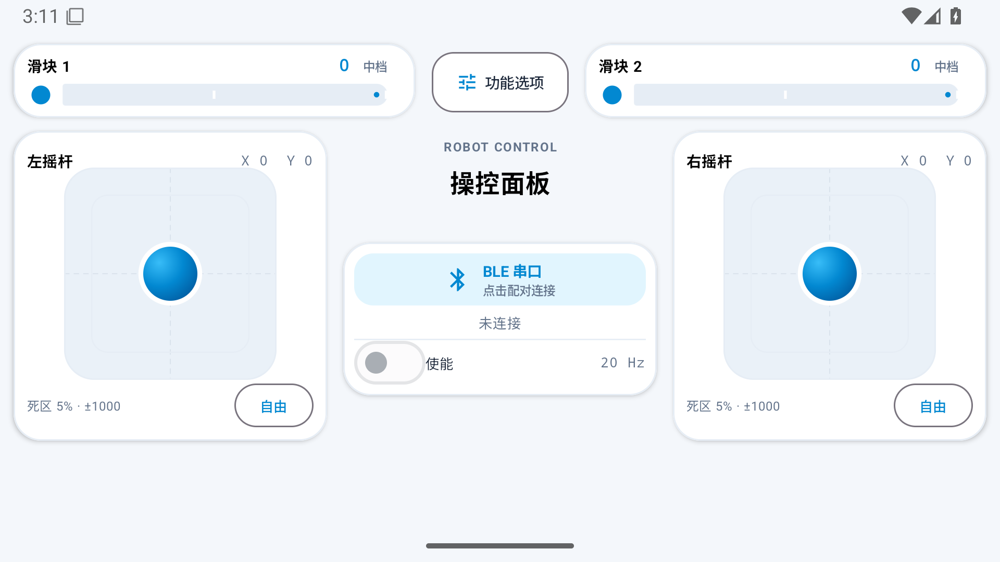

# Remote Control / 蓝牙遥控面板

横屏 Android 遥控 App：浅色圆角卡片布局、双摇杆、双滑块，可拖动编辑位置与大小，支持 **HC-05 经典蓝牙 SPP** 与 **飞易通 FSC-BT630 BLE**。另支持 FFE0/FFE1 的 **BLE 串口** 模块。三种连接方式共用 20 字节协议。STM32 提供 H723VGT6、F103C8T6 的独立 `.c/.h` 接收驱动。



## 下载与开始测试

安装 APK：[v1.3.1 下载](https://github.com/Norlive666/remote-control/releases/download/v1.3.1/remote-control-v1.3.1.apk)。Android 8.0 及以上；安装时允许来自浏览器或文件管理器的安装。

驱动源码包：[H723 / F103 两套 `.c/.h` 与协议文档](https://github.com/Norlive666/remote-control/releases/download/v1.0.0/remote-control-stm32-v1.0.0.zip)。

1. 按 [STM32 接入说明](docs/stm32.md) 接线和加入对应芯片的两个源文件。
2. **HC-05**：确认模块数据模式串口波特率为 9600、8N1；手机先在系统蓝牙中配对（PIN 以模块配置为准），App 选择 HC-05 模式、刷新并连接。STM32 调用 `RC_Init()`。
3. **BT630**：模块应运行 UART 透传固件，UART 为 115200、8N1；App 切换 BT630 BLE 并扫描连接。STM32 调用 `RC_InitBT630()`。默认检查 FFF0 / FFF2，不要求 BLE 模块与手机先在系统中配对。
如果模块在蓝牙调试器中以 BLE 连接，请在 App 选择「BLE 串口」，扫描连接。此模式按用户提供 [bt_mcu 的 BLE 默认配置](https://gitee.com/xie-rongji/bt_mcu/blob/master/app/src/main/java/xnj/lazydog/btcontroller/Bluetooth/BlueToothMaster.java) 使用 FFE0 / FFE1，默认 20 Hz，STM32 仍按模块实际 UART 波特率初始化（默认 `RC_Init()` 的 9600）。模块名称叫 HC-05 并不决定它使用经典蓝牙还是 BLE。若调试器配置过其他 UUID，本模式尚未支持该自定义配置。

4. 蓝牙连接成功后手动开启「使能」。松开摇杆自动归中；滑块保留位置。
5. **调整位置和大小**：顶部「功能选项」→「编辑布局」，拖动带框的摇杆卡片、滑块、蓝牙使能卡片，蓝色摇杆区域可独立拖动；点选组件或用底部菜单选择组件，再用大小滑条调整，点击「保存」。点击「取消」或返回键放弃草稿；「恢复默认」先恢复草稿，保存后才生效。已保存的位置和大小在重新打开 App 后保留。编辑期间关闭使能、摇杆归零，保存或取消后需手动重新使能。
6. 每个摇杆底部的方向按钮循环「自由／仅横向／仅纵向」；单轴模式下另一轴始终为 0。顶部「功能选项」分别设置两个摇杆的死区（0～30%，默认 5%）与最大绝对值（1～1000，默认 1000），点击「应用」后保存。参数或方向更改会归零该摇杆，松手后重新操作。
7. 滑块默认三档 0、1、2，保留原滑轨并增加白色刻度。功能选项可分别选择连续或分档，设置 2～8 档及各档实际值（0～1000，不可重复）；点击「应用」后回到第一档。连续模式仍显示 0～100，线上发送 0～1000。
8. 自由模式对 X/Y 分别应用死区，小幅偏移归零，斜向仍可同时输出两个轴；越过死区后连续映射到设置的最大值。设置页显示最近提交给蓝牙的数据帧，BT630 模式还显示 FFF1 通知的原始数据。

**HC-05 的 UART 参数属于模块配置，手机连接方式不能修改它。**不同固件默认值可能不同。常见完整 AT 模式为 KEY 高电平后上电、38400 波特率，查询 `AT+UART?`，设置 `AT+UART=9600,0,0`；具体以手上模块的文档及回复为准。退出 AT 模式再做遥控测试。如已配置为 115200，可用 `RC_InitBaud(115200)`；App 的 HC-05 发送频率仍为 20 Hz。

## 控制与断线行为

- HC-05 与 BLE 串口默认 20 Hz（400 字节/秒）；BT630 默认 50 Hz（1000 字节/秒）。每次写入完成后再采样最新状态，没有历史控制帧队列。
- 摇杆四轴为 −1000～1000；滑块发送配置的实际值（0～1000），默认三档 0、1、2，初始为 0，使能关闭，禁用状态在线上始终发送零控制量。
- 关闭「使能」即持续发送零控制量；上方蓝牙卡负责连接。底部重复的连接、复位、急停按钮与 HC-05 状态横条已移除。
- App 进入后台或断开时关闭使能和蓝牙。STM32 连续 300 ms 未收到有效新帧时归零、禁用并置停止；初始化、MCU 重启和恢复连接都先通过禁用帧建立序号基线，再手动使能。MCU 重启时手机仍使能的情况，请先关闭使能再开启。
- App 的「已连接」「已提交帧数」仅表示蓝牙连接和写入调用结果，**不表示 STM32 已确认收到**。v1 没有收包 ACK。
- 本项目接收驱动不直接控制电机。业务程序必须检查 `link_valid`、`enabled` 和 `stopped` 后才使用控制量。

## STM32 最少接入

以 HAL 工程为前提，加入对应芯片的 `remote_control.c` 和 `remote_control.h`：

```c
HAL_Init();
SystemClock_Config();
if (RC_Init() != HAL_OK) Error_Handler(); /* HC-05，9600 */
/* BT630 改用 RC_InitBT630() */

RC_State_t state;
RC_GetState(&state);
if (state.link_valid && state.enabled && !state.stopped) {
    /* state.axes[0..3], state.sliders[0..1] */
}
```

默认 USART1：PA9 TX → 模块 RX，PA10 RX ← 模块 TX，共地；UART 电平为 3.3V。模块供电须按裸模块或底板规格接入。驱动初始化 GPIO、USART1、TIM4 和 NVIC，不需 CubeMX 另外配置这些外设。**启动文件、HAL 和系统时钟仍由原工程提供。**USART1、PA9/PA10、TIM4 由此驱动独占；已有同名 IRQ 入口必须合并，详见 [接入文档](docs/stm32.md)。

## 协议和构建

- [20 字节协议、CRC 与示例帧](protocol/README.md)
- [验证记录与实测边界](docs/validation.md)
- 主机测试：`tests/c/run.sh`，覆盖两套驱动的拆包、连包、坏 CRC、序号、超时和恢复。
- 目标编译：`tools/compile-stm32.sh`，按脚本要求提供匹配的 STM32Cube 固件目录。
- Android：JDK 17、Android SDK 35，进入 `android/` 执行 `./gradlew testDebugUnitTest assembleRelease`。默认生成未签名 release APK；正式 APK 使用仓库外固定密钥签名。
- GitHub Actions 自动执行 Android 单元测试、APK 编译、C 测试、两种 MCU 的源文件交叉编译和模拟器界面测试。

源码、自动测试与编译检查不能代替开发板运行验证。发布记录会单独列出是否做过手机、模块与开发板的实际通信测试。

许可证：项目代码 MIT；第三方声明见 [THIRD_PARTY_NOTICES.md](THIRD_PARTY_NOTICES.md)。

## 仅在本机签名

GitHub 构建未签名 release APK，下载后由本机签名，签名密钥和密码不上传 GitHub 或 Actions Secrets。
更新版本必须使用相同密钥；请备份本机的签名目录。

本机签名目录（在仓库外）包含 `release.jks` 以及权限 600 的 `credentials.json`：
`{"password":"你的密码","alias":"remote-control"}`。使用 Android SDK Build Tools 35.0.0：

```sh
python3 tools/sign-apk.py app-release-unsigned.apk remote-control.apk \
  --build-tools /你的SDK/build-tools/35.0.0 \
  --signing-dir /你的本机签名目录
```

脚本完成对齐、签名及签名校验，密码通过临时子进程环境传入，不放进命令行参数。
