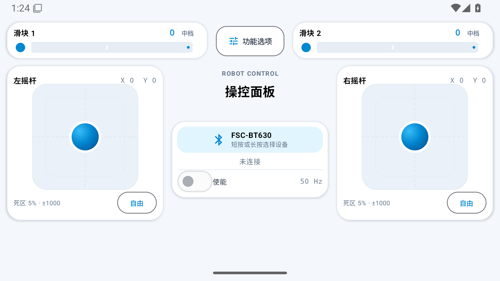

# Remote Control / 蓝牙遥控面板

横屏 Android 遥控 App：浅色圆角卡片布局、双摇杆、默认双滑块，可在设置中添加带备注的按键和滑块，支持四路 slider 输出，可拖动编辑位置与大小，使用 **飞易通 FSC-BT630 BLE** 连接和 20 字节控制协议，支持失败重试与意外断线重连。STM32 提供 H723VGT6、F103C8T6 的独立 `.c/.h` 接收驱动。



## 下载与开始测试

安装 APK：[v1.7.0 下载](https://github.com/Norlive666/remote-control/releases/download/v1.7.0/remote-control-v1.7.0.apk)。Android 8.0 及以上；安装时允许来自浏览器或文件管理器的安装。

驱动源码包：[H723 / F103 两套 `.c/.h` 与协议文档](https://github.com/Norlive666/remote-control/releases/download/stm32-v3.0.0/remote-control-stm32-v3.0.0.zip)。

BT630 移植、接线/反相、手机配置和常见错误排查见 [BT630 移植与排障指南](docs/bt630-porting.md)，包含 `BLE 写入失败 -5` 与 UART/定时器分频的区别。

1. 按 [STM32 接入说明](docs/stm32.md) 接线和加入对应芯片的两个源文件。
2. 模块应运行 UART 透传固件，UART 为 115200、8N1；STM32 调用 `RC_Init()`（默认115200；也兼容 `RC_InitBT630()`）。检查 H723 接收反相是否与实际接线一致。
3. 点击面板的 FSC-BT630 打开连接窗口，扫描并选择设备。仅支持 FFF0 服务、FFF2 写入、FFF1 通知，无需先在系统中配对；旧版连接模式设置不再影响连接。窗口只常驻显示状态和设备列表，权限、UUID、扫描详情与错误诊断收进“帮助”。
4. 蓝牙连接成功后手动开启「使能」。松开摇杆自动归中；滑块保留位置。
5. **调整位置和大小**：顶部「功能选项」→「编辑布局」，拖动带框的摇杆卡片、滑块、蓝牙使能卡片，蓝色摇杆区域可在整个操控画布内独立拖动，允许移到白色卡片外；点选组件或用底部菜单选择组件，再用大小滑条在 30%～250% 调整，点击「保存」。点击「取消」或返回键放弃草稿；「恢复默认」先恢复草稿，保存后才生效。滑块及卡片内容随外框等比缩放；蓝色摇杆大小可独立调整。实际最大尺寸受画布边界限制。已保存的位置和大小在重新打开 App 后保留。编辑期间关闭使能、摇杆归零，保存或取消后需手动重新使能。
6. 每个摇杆底部的方向按钮循环「自由／仅横向／仅纵向／四向」；单轴模式下另一轴始终为 0。四向模式只输出横向或纵向，另一轴为 0；拖动更偏横向选 X，更偏纵向选 Y，恰好 45° 时优先纵向。使用径向死区，力度随距离连续变化，松手归零；旧八向设置自动转换为四向，保留范围、死区和布局。顶部「功能选项」分别设置两个摇杆的死区（0～30%，默认 5%）与最大绝对值（1～1000，默认 1000），点击「应用」后保存。参数或方向更改会归零该摇杆，松手后重新操作。
7. 滑块默认三档 0、1、2，保留原滑轨并增加白色刻度。功能选项可分别选择连续或分档，设置 2～8 档及各档实际值（0～1000，不可重复）；点击「应用」后回到第一档。连续模式仍显示 0～100，线上发送 0～1000。
8. 自由模式对 X/Y 分别应用死区，小幅偏移归零，斜向仍可同时输出两个轴；越过死区后连续映射到设置的最大值。设置页显示最近提交给蓝牙的数据帧和 FFF1 通知的原始数据。

**UART 参数属于模块配置，手机连接不会修改它。**STM32 初始化波特率应与模块实际参数一致；如模块已配置为 115200，可用 `RC_InitBaud(115200)`。

连接失败或意外断线时，一轮最多尝试 5 次（含首次），间隔 1、2、4、4 秒，可随时取消。稳定连接满 10 秒后，下一次意外断线可开启新一轮；刚连上就失败不会无限重试。主动断开、App 后台或取消会停止重试。重连后使能保持关闭，需手动重新开启；不重放断线前的控制帧。服务/特征不匹配、缺少权限、蓝牙关闭等明确配置问题直接停止。

## 自定义组件与四路输出（v1.7.0）

[实际示例布局](docs/custom-controls.png)（模拟器中添加三个按钮后调整布局；默认仍只有两个滑块）。

默认仍是两个滑块。在功能选项的组件管理中添加、修改或删除组件，设置名称、下方一行小字备注和目标通道 slider1～4（STM32 对应 `sliders[0..3]`），所有数值范围0～1000。新增组件沿用布局编辑的拖动、30%～250%缩放和保存功能，重启后保留。

- 普通按钮：按下输出设定值，松手或取消归零。
- 长短按按钮：不足500ms松手，输出短按值100ms后归零；按住达到500ms输出长按值，松手归零；短按与长按互斥。100ms是App输出状态持续时间，不代表STM32已确认收到脉冲。
- 点击切换：每次点击切换至下一个配置值，例如0→1→2→0，松手保持，无需滑动。
- 滑块：保留连续/分档功能，可添加第三、第四通道；现有默认两个滑块不变。

**安装新App前请升级STM32驱动到v3.0.0。** App改发v2四路帧，仍为20字节；新驱动同时接收旧版v1两路帧，旧帧缺少的两路清零。旧驱动不能解析新版App的v2帧。必须一起重新编译驱动`.c/.h`及使用`RC_State_t`的业务代码；保留实际板卡的波特率、反相和已有接收修补，初始化函数不变。已有本地定制驱动应合并升级，避免覆盖原有诊断与波形处理。

## 蓝牙扫描权限

按 bt_mcu 同时使用系统发现与默认 BLE 扫描，按地址去重。系统结果只列出 LE/DUAL 设备；不按设备名过滤，避免漏掉改名的模块。扫描最多20秒，一条扫描失败时另一条继续；两路数量/错误可在连接窗口的帮助中查看。

首次搜索请允许「附近设备」（Android12+）和「精确位置」权限，并开启手机定位开关。定位权限用于蓝牙搜索，不读取 GPS 坐标。连接或重试期间不启动刷新扫描，需要先明确取消/断开；后台、连接和关闭搜索窗口会停止扫描并注销接收器。

如果仍看不到模块，请反馈扫描状态、两路数量/错误、手机型号和 Android版本。源码、模拟器不能确认真实 BT630 广播已被发现。

## 控制与断线行为

- BT630 名义 50 Hz（1000 字节/秒），实际速率包含等待写入完成的时间。每次写入完成后延迟 20 ms，再采样最新状态，没有历史控制帧队列。
- 摇杆四轴为 −1000～1000；滑块发送配置的实际值（0～1000），默认三档 0、1、2，初始为 0，使能关闭，禁用状态在线上始终发送零控制量。
- 关闭「使能」即持续发送零控制量；中央蓝牙卡负责连接。
- App 进入后台或断开时关闭使能和蓝牙。STM32 连续 300 ms 未收到有效新帧时归零、禁用并置停止。驱动 v2.3.0 起，初始化、重置或超时后的首个合法帧即可建立序号基线，允许使能帧直接恢复输出；仅 MCU 超时且手机仍使能时，通信恢复后无需切换使能。App 主动断开、进入后台或实际重连仍会关闭使能，需手动重新开启。
- App 的「已连接」「已提交帧数」仅表示蓝牙连接和写入调用结果，**不表示 STM32 已确认收到**。v1 没有收包 ACK。
- 本项目接收驱动不直接控制电机。业务程序必须检查 `link_valid`、`enabled` 和 `stopped` 后才使用控制量。

## STM32 最少接入

以 HAL 工程为前提，加入对应芯片的 `remote_control.c` 和 `remote_control.h`：

```c
HAL_Init();
SystemClock_Config();
/* 保留已有 MX_DMA_Init()/MX_USARTx_UART_Init() 等调用，先完成全部外设初始化。 */
if (RC_Init() != HAL_OK) Error_Handler(); /* 下载包默认115200，用于BT630 */
/* H723默认接收反相=1，适用于本板D-Bus接口；直接PD9须改为0。 */

RC_State_t state;
RC_GetState(&state);
if (state.link_valid && state.enabled && !state.stopped) {
    /* state.axes[0..3], state.sliders[0..3] */
}
```

H723：USART3，PD8 TX → 模块 RX、PD9 RX ← 模块 TX，TIM5。F103：USART1，PA9 TX → 模块 RX、PA10 RX ← 模块 TX，TIM4。两端共地，UART 电平3.3V，模块供电按模块规格。驱动自动初始化对应GPIO、USART、定时器和NVIC，无需CubeMX配置或生成uart.c/tim.c，无需UART/TIM HAL模块。基础HAL/RCC（H723包括RCCEx）、启动文件和系统时钟仍由原工程提供。

v2.2.0允许保留CubeMX生成文件及目标UART初始化：只要尚未启动其他DMA/中断收发，随后调用Init即可；活动收发和占用的定时器仍返回HAL_BUSY，保留原状态。成功后UART由本驱动独占，不要再次初始化或用于其他业务。当前下载包的 `RC_DEFAULT_BAUD` 默认115200；H723的 `RC_RX_INVERT` 默认1，与本机实测D-Bus接口配置一致，直接连接PD9时改为0。F103默认115200、不反相，不支持硬件反相。已有生成IRQ入口无需修改，H723原USART1/TIM4不由本驱动占用。完整顺序、配置和接线见[接入文档](docs/stm32.md)。

## 协议和构建

- [20 字节协议、CRC 与示例帧](protocol/README.md)
- [验证记录与实测边界](docs/validation.md)
- 主机测试：`tests/c/run.sh`，覆盖两套驱动的拆包、连包、坏 CRC、序号、超时和恢复。
- 目标编译：`tools/compile-stm32.sh`，按脚本要求提供匹配的 STM32Cube 固件目录。
- Android：JDK 17、Android SDK 35，进入 `android/` 执行 `./gradlew testDebugUnitTest assembleRelease`。默认生成未签名 release APK；正式 APK 使用仓库外固定密钥签名。
- GitHub Actions 自动执行 Android 单元测试、APK 编译、C 测试、两种 MCU 的源文件交叉编译和模拟器界面测试。

源码、自动测试与编译检查不能代替开发板运行验证。发布记录会单独列出是否做过手机、模块与开发板的实际通信测试。

许可证：项目代码 MIT；第三方声明见 [THIRD_PARTY_NOTICES.md](THIRD_PARTY_NOTICES.md)。

## 仅在本机签名

GitHub 构建未签名 release APK，下载后由本机签名，签名密钥和密码不上传 GitHub 或 Actions Secrets。
更新版本必须使用相同密钥；请备份本机的签名目录。

本机签名目录（在仓库外）包含 `release.jks` 以及权限 600 的 `credentials.json`：
`{"password":"你的密码","alias":"remote-control"}`。使用 Android SDK Build Tools 35.0.0：

```sh
python3 tools/sign-apk.py app-release-unsigned.apk remote-control.apk \
  --build-tools /你的SDK/build-tools/35.0.0 \
  --signing-dir /你的本机签名目录
```

脚本完成对齐、签名及签名校验，密码通过临时子进程环境传入，不放进命令行参数。

### v1.6.0 BT630 连接重构

连接部分移植并适配 bt_mcu 的原生 GATT 流程，只保留 BT630 UUID，移除旧通用串口入口及 Nordic BLE 依赖。新增有上限、可取消的失败重试和意外断线重连，重连后需手动使能；带响应写入优先，错误回调不会被当成成功。连接窗口使用独立滚动的设备列表，长说明与诊断收进帮助。[连接窗口截图](docs/bt630-connection.png)（模拟器测试设备列表）。来源和 Mulan PSL v2 许可证见第三方声明。

### X5 Lite / 原生安卓手柄（v1.5.0）

X5 Lite 通过 Type-C 连接手机，使用安卓模式（深蓝灯），无需触屏映射工具。App读取原生手柄事件，沿用现有BLE连接和STM32协议。左右摇杆复用面板死区、输出范围、自由/单轴/四向模式；向上为正Y。

在面板设置中打开「手柄按键映射」。X/Y/L2 默认将滑块1设为0/1/2，L1/R1/R2默认将滑块2设为0/1/2；若有自定义分档则使用第一、中间和最后档。每键可选择目标滑块与设值，按下生效、松开保持。分档滑块选择已有值，连续滑块可填0～1000。可恢复默认，配置保存在手机。更改分档后失效的按键设值回到该滑块第一档。

扳机达到60%视为按下，降至40%后才允许再次触发；扳机轴和数字按键事件合并去重，按住重复事件不会覆盖触屏设值。仍使用触屏使能，未新增A/B快捷键。拔出手柄、切后台或打开弹窗后清零并关闭使能，返回后需手动使能。布局编辑期间忽略手柄输入。多个输入设备由实际有效输入接管；更换设备会关闭使能，其他设备的空闲零值不抢选。

APK签名密钥仅保存在本机。自动测试不等同于X5 Lite实物兼容性验证；具体手机的右摇杆轴、扳机事件与USB连接仍需实测。


### v1.5.1 手柄设备选择修复

旧版本启动时选中系统列出的首个手柄设备，可能导致真实手柄事件因ID不一致被忽略。用户报告小米手机显示uinput-xiaomi；新版本不按名称屏蔽设备，改为关闭弹窗后由有效摇杆/按键输入接管。首次接管遵循用户配置的死区、范围和方向模式，当前设备回零正常处理。

「手柄按键映射」显示最近事件的设备ID、输入源、原始摇杆/扳机值；设备名由安卓提供，不能单凭名称判断有效性。若仍无响应，请反馈这段信息，并确认X5 Lite使用原生安卓模式（深蓝灯）。此修复有自动回归覆盖，用户实机仍需验证。
